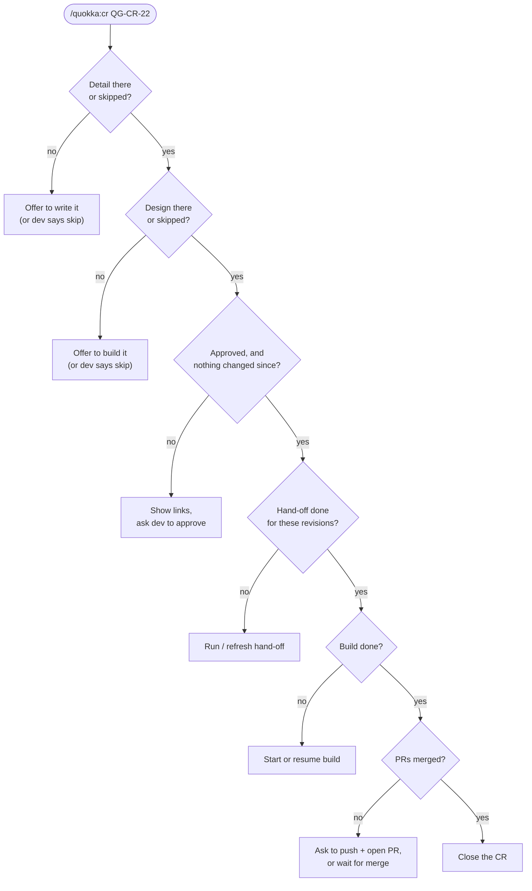
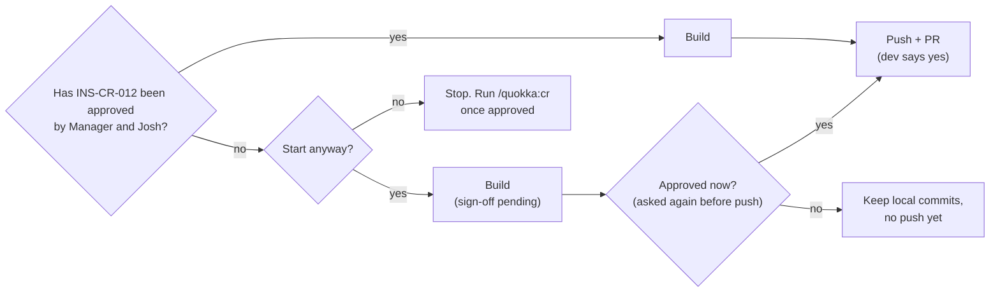
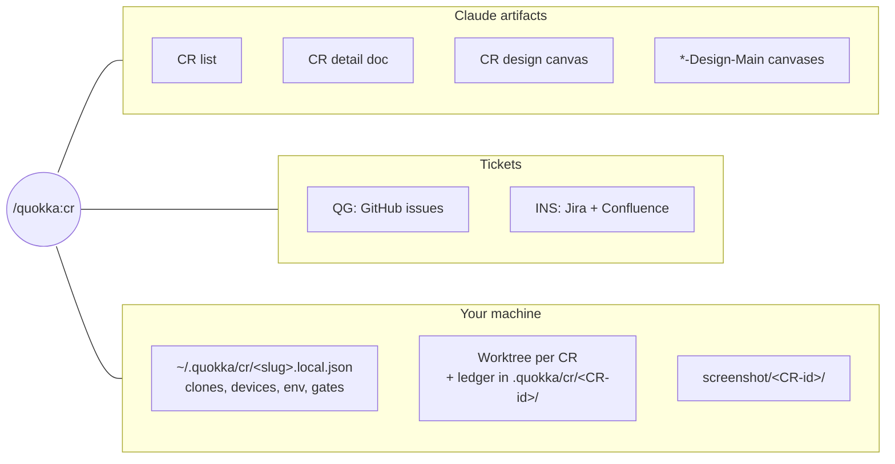

# Quokka AI

Shared Claude Code commands and skills for the Quokkapps team:

- **`/quokka:cr`**: the change-request (CR) flow, from idea to merged code, for QuokkaGuide (QG) and INS.
- **`/quokka:feature-test-design`**: a test plan for a mobile feature before you build it.

## Quick start

```bash
npx --yes github:quokkapps/quokka_skills    # install (restart Claude Code after)
```

```
/quokka:cr-setup qg        # once per project (qg or ins)
/quokka:cr-health          # check this machine is ready
/quokka:cr                 # list open CRs and the next step for each
/quokka:cr QG-CR-22        # move a CR forward; Claude asks before each step
/quokka:cr-help            # how the flow works
```

## The CR flow

A change request is one feature or change. It has an id (`QG-CR-07`, `INS-CR-012`) and a row on the project's CR list. Claude writes no product code until a developer approves the CR.

```mermaid
flowchart LR
    new["New<br/>row on the CR list"] --> detail["Detail<br/>Claude Docs doc"]
    detail --> design["Design<br/>canvas, one page per surface"]
    design --> approve{{"Approve<br/>dev reviews both"}}
    approve --> handoff["Hand-off<br/>main canvas + tickets"]
    handoff --> build["Build<br/>test-first, Codex review,<br/>screenshots"]
    build --> pr{{"Push + PR<br/>dev says yes"}}
    pr --> merge(["Merge on GitHub /<br/>Bitbucket (human)"])
    merge --> close["Close<br/>CR Done, tickets closed"]

    detail -. "simple CR:<br/>dev skips" .-> design
    design -. "no UI change:<br/>dev skips" .-> approve
```



| Step | What happens | Who decides |
|---|---|---|
| New | Adds a row to the CR list. The row needs no approval. | dev |
| Detail | Claude reads the real code and writes the detail doc: problem, proposal, screens, repos, edge cases, numbered acceptance criteria. | Claude writes, dev reviews |
| Design | Claude builds the design canvas, one page per surface (app, web), each in that surface's design system. | Claude writes, dev reviews |
| Approve | The dev reviews the detail and the design, then approves once. The approval locks both revisions. | **dev** |
| Hand-off | Copies the design into the `*-Design-Main` canvases, drafts the tickets (dev confirms), and creates them. INS also gets a Confluence page. | dev confirms the tickets |
| Build | Builds in a new worktree and branch: tests first, gates, Codex review until clean, `/simplify`, proof screenshots. | Claude |
| Push + PR | Claude shows the draft PR and asks before it pushes. It never merges. | **dev** |
| Close | After the merge, marks the CR Done and closes the tickets. | dev |

### One command moves a CR forward

`/quokka:cr <CR-id>` reads the CR's row and runs the next step. It stops at every checkpoint where a person decides.



### Skipping the detail or design

For a simple CR, tell Claude to skip a part: "no design needed, it's a copy fix". Claude never skips a part on its own.

- **Skip the detail:** Claude writes a short scope on the row instead: what changes, which repos, and numbered acceptance criteria. That scope is what you approve, and the build writes its tests from it.
- **Skip the design:** fine when nothing visible changes. The hand-off skips the canvas copy.

### When things change after approval

If someone edits the detail, the design or the scope after you approve, the approval goes **stale**. Claude stops and asks you to review and approve again. A hand-off done for older revisions is refreshed before the build. A build in progress is re-checked against the new revisions.

### INS: Manager and Josh

INS runs the same flow. The only extra is one question before the build starts.



A "no" never blocks local work. It only holds the push and the PR. Claude records your answer with your login.

## Commands

| Command | What it does |
|---|---|
| `/quokka:cr-setup [qg\|ins]` | One-time setup per project. Maps every repo the project needs (QG: `quokkaguide-kmp` **and** `quokkaguideweb`; INS: LifeGuardian Android, iOS and Connect). Checks logins, picks the Android emulator and iOS simulator, checks JDK/Node, and saves the real gate commands. |
| `/quokka:cr-health [qg\|ins]` | Read-only check of this machine: which projects are set up, and anything missing (clones, remotes, git-ignored secret files, logins, emulator/simulator, env, gate commands, Codex, installed version). Each problem comes with its fix. |
| `/quokka:cr [<CR-id>]` | With no argument, lists open CRs and the next step for each. With a CR id, runs that CR's next step. `/quokka:cr new <idea>` adds a CR. |
| `/quokka:cr-help [topic\|CR-id]` | Explains the flow in plain words. With a topic (`approve`, `skip`, `build`, …), explains just that. With a CR id, shows where the CR stands. It changes nothing. |
| `/quokka:feature-test-design <feature>` | For Android / iOS / KMP: interviews the dev, researches the live code, and writes a test plan that marks the must-test 20%. Writes to `docs/test-plans/`, with an optional Confluence page. |
| `/quokka:update` | Updates to the latest version from GitHub. |

The explicit CR steps still work if you want one step on its own: `detail`, `design`, `approve`, `handoff`, `build`, `close`, `resume`. Tam alone runs `cleanup`.

## Where things live



- **Project files** (`projects/qg.json`, `projects/ins.json`) ship with this package. They hold the surfaces, design canvases, ticket systems, repo ids, gate commands and device rules. Field reference: [`projects/README.md`](projects/README.md).
- **Local files** (`~/.quokka/cr/<slug>.local.json`, mode 600) are written by `/quokka:cr-setup` and never leave your machine. They hold your clone paths, devices, environment and your gate commands, which replace the project file's.
- **Ledger:** each build keeps `progress.md`, `decisions.md`, `uat.md` and Codex reviews in `<worktree>/.quokka/cr/<CR-id>/`. Git ignores this folder.

## Rules Claude always follows

- No product code without an approval that is still current.
- Never merges. Never pushes or opens a PR without the dev's yes.
- Never deletes artifacts, tickets or pages. Only `cleanup` deletes, with a typed confirmation per CR.
- Never overwrites someone else's work on a canvas, doc or list.
- Identity comes from the dev's `gh` / Bitbucket / `acli` login, never the shared Claude account.
- Android installs go to the configured emulator only (`adb -s <emulator>`). Never runs Gradle `install*` or `connected*` tasks. iOS uses the simulator only.
- Copies git-ignored secret files into worktrees without printing them. Never commits them.

## Installation

Run from any project directory:

```bash
npx --yes github:quokkapps/quokka_skills
```

| What | Where |
|---|---|
| `/quokka:cr`, `cr-setup`, `cr-health`, `cr-help` and the `quokka-cr` skill | global: `~/.claude/commands/quokka/`, `~/.claude/skills/quokka-cr/` (or `$CLAUDE_CONFIG_DIR`) |
| Shipped project files | `~/.quokka/cr/projects/` |
| `/quokka:feature-test-design`, `/quokka:update` and their skill | the nearest `.claude/` directory |

Updating from v1.3 or earlier removes the retired `/quokka:port-feature` and `/quokka:port-gsd-feature` commands and the `SessionEnd` knowledge-base hook. Your other settings and hooks are kept.

## Updating

```
/quokka:update
```

Or from a terminal: `npx --yes github:quokkapps/quokka_skills`. The installer says "Already up to date", or "Updating from vX to vY". Restart Claude Code after an update.

## Uninstalling

```bash
npx github:quokkapps/quokka_skills --uninstall
```

Your local files in `~/.quokka/cr/` are kept.

## Development

- `bin/install.js` handles install, update and uninstall. `node test/install.test.js` tests it.
- Versions come from `package.json` and git tags (`git tag v1.5.0 && git push --tags`).
- Review changes with Codex before opening a PR.
